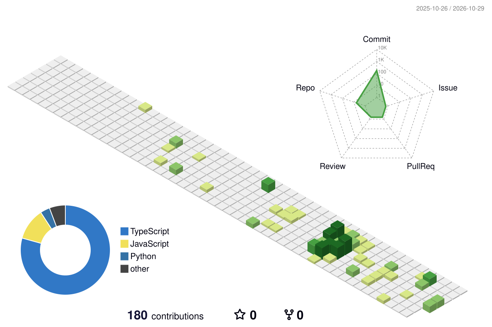

 <div align="center">

# `GUNJAN MAHARA`

### ⚡ FULL STACK DEVELOPER · 


[](https://github.com/Gunjan34)
[](https://www.linkedin.com/in/gunjan-mahara-364733258)
[](mailto:gunjanmahara2@gmail.com)

📍 Delhi, India

</div>

---

## `01 // ABOUT ME`

```text
> Developer status: ONLINE
> Primary focus: Frontend Engineering
> Core stack: React + TypeScript
> Exploring: Cloud & DevOps Engineering
> Mission: Build. Automate. Scale.
```

I'm a software developer passionate about building responsive web applications, developing REST APIs, and integrating AI-powered features.

- 💻 Experienced in MERN stack development.
- ⚛️ Working with React and TypeScript for frontend development.
- 🤖 Built AI-powered applications using the Gemini API.
- 🔐 Familiar with JWT authentication and role-based access control.
- 👥 Led a team project to develop an HR Management System.
- 🌱 Learning Linux, CI/CD, AWS, Docker, and DevOps fundamentals.
- 🎯 Long-term goal: Grow into a DevOps Engineer.

---

## `02 // TECH ARSENAL`

### Languages


### Frontend Engineering


### Backend & Databases


### Cloud, DevOps & Tools


---

## `03 // EXPERIENCE`

### AI Code Reviewer Intern — Edunet Foundation

**June 2025 – July 2025 · Remote**

- Built an AI-powered code reviewer using the MERN stack and Gemini API.
- Designed a live code editor with AI-generated suggestions.
- Implemented JWT authentication to secure user sessions.
- Stored code review history in MongoDB.
- Collaborated with mentors to improve the application.

---

## `04 // PROJECTS`

### 🤖 AI Code Reviewer

An AI-powered tool that helps developers review code and identify potential improvements.

- Integrated Gemini API suggestions into a live code editor.
- Implemented authentication and code review history.
- **Stack:** MERN, Gemini API, JWT.

### 📝 Notes Application with Integrated Chatbot

A full-stack notes application with AI-powered assistance.

- Integrated Gemini API for contextual Q&A and note suggestions.
- Implemented JWT-based authentication.
- Developed REST APIs and a responsive user interface.
- **Stack:** React, Node.js, Express, MongoDB, Gemini API.

### 👥 Human Resource Management System

A team project focused on employee management workflows.

- Led a team developing an HR management application.
- Designed employee management, attendance, and payroll modules.
- Implemented authentication and role-based access control.

### 🛒 E-Commerce Website

A responsive shopping website built with core web technologies.

- Created product listings and shopping cart functionality.
- Implemented order placement features.
- **Stack:** HTML, CSS, JavaScript.

🔗 [Explore all repositories →](https://github.com/Gunjan34?tab=repositories)

---

## `05 // GITHUB ANALYTICS`

<div align="center">


</div>

---

## `06 // 3D CONTRIBUTION MATRIX`

<div align="center">

<!-- Generated by the GitHub Profile 3D Contrib workflow -->


</div>

---

## `07 // CONTRIBUTION SNAKE`

<div align="center">

<!-- Generated by the GitHub contribution snake workflow -->

<picture>
  <source media="(prefers-color-scheme: dark)" srcset="https://raw.githubusercontent.com/Gunjan34/Gunjan34/output/github-snake-dark.svg" />
  <source media="(prefers-color-scheme: light)" srcset="https://raw.githubusercontent.com/Gunjan34/Gunjan34/output/github-snake.svg" />
  
</picture>

</div>

---

## `08 // EDUCATION`

**B.Tech in Computer Science and Engineering**  
Avviare Educational Hub · 2022–2026

**School Education**  
Rajeev Gandhi Navodaya Vidyalaya, Syat Kotabagh · Completed 2022

---

## `09 // CERTIFICATIONS`

- C, C++ and Node.js Full-Stack Development (2023–2024)
- Data Structures and Algorithms — Unstop (2024)
- React Hooks Crash Course — GreatStack (2024)

---

## `10 // CURRENT LEARNING PATH`

```text
[IN PROGRESS]
├── Linux & Shell Fundamentals
├── CI/CD Pipelines
├── AWS Cloud Fundamentals
├── Docker & Containerization
└── Application Deployment & Monitoring
```

---

<div align="center">

### `SYSTEM MESSAGE: KEEP BUILDING.`

**Thanks for visiting my profile!**

*Turning ideas into applications, and applications into reliable deployments.* 💜

[GitHub](https://github.com/Gunjan34) · [LinkedIn](https://www.linkedin.com/in/gunjan-mahara-364733258) · [Email](mailto:gunjanmahara2@gmail.com)


</div>
